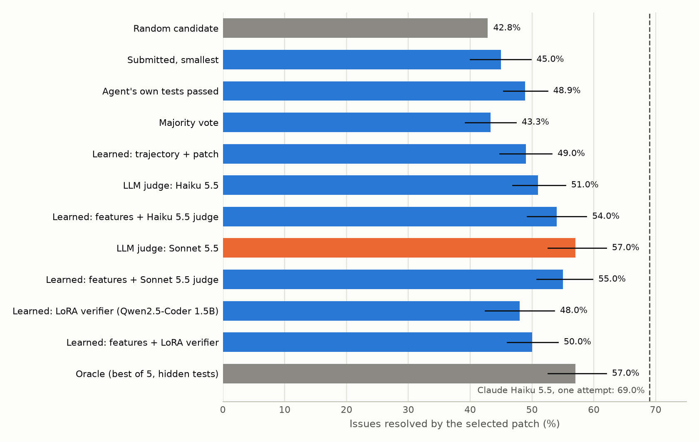
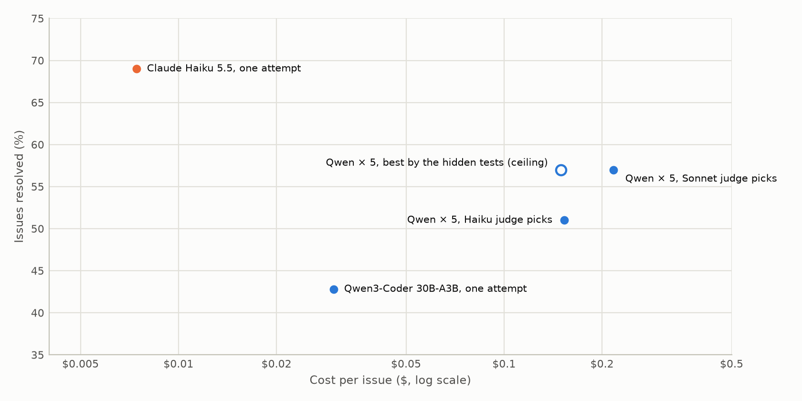
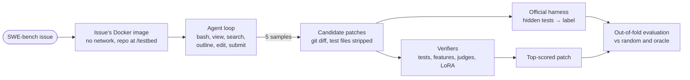

# swe-verifier

**A coding agent written from scratch for SWE-bench Lite, run five times per issue, and verifiers that pick
which of the five patches to ship.** Measured on 100 real GitHub issues with the official harness: every
candidate patch is scored by the repository's hidden tests, and every verifier is compared out of fold with a
random pick and an oracle.

<picture>
  <source media="(prefers-color-scheme: dark)" srcset="docs/selection-dark.png">
  
</picture>

*Picking one of five patches from Qwen3-Coder 30B-A3B, an open model, on 100 issues. The bars are the share of
issues resolved by the patch each method picks; the lines are 95% bootstrap intervals.*

**In one minute:**

- **Picking well is worth at most 14 points, and only on a third of the issues.** One random candidate resolves
  42.8% of the issues, the best of the five 57.0%. On 43 issues all five candidates fail and on 25 all five pass,
  so selection can only change the outcome on the other 32.
- **Signals the agent leaves for free get 40% of the way.** Whether the agent's own last test run passed
  (+6.1 points) and a logistic regression on the trajectory and patch (+6.2) need no extra model call. Majority
  vote, the usual self-consistency trick, does nothing (+0.5), even though its pooled AUC (0.765) looks good.
  A 1.5B code model fine-tuned with LoRA to read the issue and the patch does no better (+5.2, interval
  includes 0): 400 training candidates are not enough to learn verification.
- **The best verifier was remembering, not verifying.** A Claude Sonnet 5.5 judge picks exactly as well as the
  oracle. In 82% of its reviews it cites "the upstream fix", sometimes the name of the hidden test: SWE-bench
  issues and their fixes are public, and a frontier judge has read them. Its score is a contaminated upper
  bound, not a measure of verification.
- **Check the cheaper frontier model first.** Claude Haiku 5.5, one attempt, resolves 69.0% of the issues for
  $0.007 each. Five Qwen attempts and the best judge reach 57.0% for $0.22: the open model is cheaper per token
  but takes four times as many steps.

## Results

100 issues from [SWE-bench Lite](https://www.swebench.com/lite.html), the first 100 of a seeded shuffle whose
reference patch passes the harness on this machine (2 of 103 fail because their tests need the network). A
patch is resolved when the issue's hidden tests pass and the tests that passed before still pass.

### 1. The agents

The same loop, tools and prompt for both models: [agent.py](src/sweverifier/agent.py), 40 steps at most. Qwen3-Coder
samples five candidates per issue at temperature 0.7; Haiku makes one attempt at temperature 0.

| Agent | Attempts per issue | Resolved (one attempt) | Cost / attempt | Steps | Minutes | Submitted | Empty patch |
|---|---|---|---|---|---|---|---|
| Qwen3-Coder 30B-A3B (open) | 5 | **42.8%** | $0.0299 | 34.6 | 5.6 | 63.0% | 11.4% |
| Claude Haiku 5.5 | 1 | **69.0%** | $0.0074 | 8.5 | 0.9 | 99.0% | 1.0% |

*Minutes on an M1 laptop, where Docker emulates the x86 SWE-bench images. Both models through OpenRouter, the
cost read from every response.*

- **Qwen often runs out of steps.** 37% of its attempts never call `submit`. Their patches still count, and 24%
  of them resolve the issue, so a verifier has to look at unfinished work too.
- **Haiku solves 13 issues that Qwen never solves in five tries; Qwen solves 1 that Haiku misses.** More
  samples from a weaker model do not cover what a stronger model gets right.

### 2. Picking one of five candidates

Every method gives each candidate a score, and the top-scored one is shipped (ties shared equally, so no lucky
tie-break). Learned methods are trained out of fold: five folds grouped by issue, so an issue is never scored by
a model that saw any of its candidates. Intervals: 2,000 bootstrap resamples of the issues, on the gain over a
random pick.

| Method | Resolved | Gain (points) | AUC within an issue | AUC pooled | Verifier cost / issue |
|---|---|---|---|---|---|
| Random candidate (pass@1) | 42.8% | – | – | – | – |
| Submitted, then smallest patch | 45.0% | +2.2 (−2.8 to +7.0) | 0.587 | 0.685 | – |
| Agent's own tests passed | 48.9% | +6.1 (+2.6 to +9.7) | 0.729 | 0.656 | – |
| Majority vote (most similar to the others) | 43.3% | +0.5 (−3.6 to +4.6) | 0.626 | 0.765 | – |
| Learned: trajectory and patch features | 49.0% | +6.2 (+2.0 to +10.4) | 0.680 | 0.715 | – |
| LLM judge: Claude Haiku 5.5 | 51.0% | +8.2 (+4.1 to +12.6) | 0.901 | 0.905 | $0.0035 |
| Learned: features + Haiku judge | 54.0% | +11.2 (+6.4 to +16.0) | 0.924 | 0.873 | $0.0035 |
| LLM judge: Claude Sonnet 5.5 † | 57.0% | +14.2 (+9.8 to +19.2) | 0.997 | 0.971 | $0.0669 |
| Learned: features + Sonnet judge † | 55.0% | +12.2 (+8.0 to +17.0) | 0.958 | 0.942 | $0.0669 |
| Learned: LoRA verifier (Qwen2.5-Coder 1.5B) | 48.0% | +5.2 (−0.4 to +10.8) | 0.608 | 0.635 | – |
| Learned: features + LoRA verifier | 50.0% | +7.2 (+3.2 to +11.4) | 0.690 | 0.702 | – |
| Oracle: best of 5 by the hidden tests | 57.0% | +14.2 (+9.8 to +19.2) | 1.000 | 1.000 | – |
| *Claude Haiku 5.5 as the agent, one attempt* | *69.0%* | | | | |

† Contaminated: the judge recognizes the upstream fix (section 4).

- **The AUC that matters is within an issue.** Selection compares the five candidates of one issue with each
  other. A pooled AUC also rewards telling easy issues from hard ones: five candidates that agree are usually an
  easy issue, so majority vote ranks well across issues (0.765) and badly within one (0.626).
- **The features are trajectory and patch signals:** steps, whether the agent submitted or hit the limit, edits
  that failed to apply, test runs and whether the last one passed, the size of the patch, and its agreement with
  the four other candidates ([features.py](src/sweverifier/features.py)).
- **A fine-tuned small model is not a verifier yet.** Qwen2.5-Coder 1.5B, trained with LoRA as a classifier on
  the issue and the patch ([notebook](notebooks/verifier_lora.ipynb), on a Colab GPU), reaches an AUC
  of 0.635 out of fold and picks 48.0%: +5.2 points, an interval that includes 0, and below the free signal
  of the agent's own tests. Its folds range from 0.42 to 0.81 AUC: with 20 issues per fold, the score depends
  more on which issues land in the fold than on the model. Added to the features it is worth +1
  point. The judges get their edge from reading code they were never trained on here; the small model only
  has 400 labelled candidates, 32 issues of which actually disagree.
- **Features add to a weak judge, not to a strong one.** They lift the Haiku judge by 3 points and pull the
  Sonnet judge down by 2: with 500 candidates, the regression adds noise to an already near-perfect score.
- **What the agent's tests are worth.** When the agent's last test run passed, its patch resolves the issue 50%
  of the time, against 42% when it failed. Only 46% of the attempts end with a test output the parser can read.
  On Django it is 28%: in 192 of its 210 Django attempts the agent calls `pytest`, which Django's environment
  does not have.

### 3. Cost per issue

<picture>
  <source media="(prefers-color-scheme: dark)" srcset="docs/cost-dark.png">
  
</picture>

| System | Resolved | Cost / issue |
|---|---|---|
| Qwen3-Coder 30B-A3B, one attempt | 42.8% | $0.030 |
| Qwen × 5, Haiku judge picks | 51.0% | $0.153 |
| Qwen × 5, Sonnet judge picks | 57.0% | $0.217 |
| Qwen × 5, best by the hidden tests (ceiling) | 57.0% | $0.150 |
| **Claude Haiku 5.5, one attempt** | **69.0%** | **$0.007** |

- **Price per token is not price per task.** Qwen3-Coder is listed at $0.07 / $0.28 per million tokens against
  Haiku's $0.10 / $0.50, but it takes 34.6 steps per attempt against 8.5, and every step resends a growing
  context. One Qwen attempt costs four times one Haiku attempt.
- **Best-of-N does not close a capability gap.** Even a perfect verifier stops at 57.0%, twelve points below
  one Haiku attempt. Sampling and verifying pay off when the candidates are already close to the target: on
  this agent loop, the open model was not.

### 4. The judge remembers the fix

The judges see the issue and one patch, nothing else: no tests, no trajectory, no network
([judge.py](src/sweverifier/judge.py)). Their reviews still describe the change that was merged upstream:

```text
pydata__xarray-4094       The upstream fix is `sel({variable_dim: k}, drop=True)`, which drops these leftover
                          scalar coordinates...
sphinx-doc__sphinx-8627   The upstream fix added a `INVALID_BUILTIN_CLASSES` mapping...
django__django-13551      The upstream test for this issue, `test_token_with_different_email`, includes
                          `CustomEmailField` cases...
```

Two measurements, on the 214 correct non-empty patches split by their similarity to the upstream fix
(Jaccard similarity of the changed lines):

| Judge | Reviews citing the upstream fix | Correct patch close to upstream (n=55) | Correct patch unlike upstream (n=123) |
|---|---|---|---|
| Claude Haiku 5.5 | 92 of 443 (20.8%) | 0.84 | 0.69 |
| Claude Sonnet 5.5 | 362 of 443 (81.7%) | 0.92 | 0.83 |

*Mean probability the judge gives the patch. "Citing" is a keyword match on the visible review (upstream,
actual fix, merged, commit...).*

- **Both judges prefer a correct patch that looks like the known fix.** At equal correctness, a patch unlike
  upstream loses 9 to 15 points of confidence. A judge that verified the change would not care how it is
  written.
- **So the judge rows measure memory as much as verification.** On private code, or on issues created after
  the judge's training cutoff, they would score lower. The verifiers that learn from this run only (the agent's
  tests, the features, the LoRA verifier) are not affected: they have never seen the fix.

## How it works



- **Environment** ([env.py](src/sweverifier/env.py)): one container per attempt from the issue's own SWE-bench
  image, with no network, driven by `docker exec`. Each command runs in a login shell with the project's
  environment and an in-container timeout.
- **Agent** ([agent.py](src/sweverifier/agent.py), [tools.py](src/sweverifier/tools.py)): a hand-written
  tool-calling loop over any OpenAI-compatible API, with no agent framework. Six tools: a shell, a file viewer
  with line numbers, `grep -E` search, a tree-sitter outline of a Python file, an exact-match editor that
  refuses ambiguous edits, and `submit`. The patch is `git diff`, without the test files, which the harness
  replaces with the issue's own.
- **Scoring** ([evaluate.py](src/sweverifier/evaluate.py)): the official `swebench` harness, unmodified, on
  every candidate. Each issue's reference patch is run first; an issue whose reference fails here is skipped.
- **Run** ([runner.py](src/sweverifier/runner.py)): issues in parallel under a container limit, resumable
  from its JSONL files, with a spending cap. Each issue's image (about 2.3 GB) is deleted when it is done.
- **Verifiers** ([verifier.py](src/sweverifier/verifier.py), [judge.py](src/sweverifier/judge.py)): the
  baselines, the features, the judges, the out-of-fold regressions, best-of-N selection and the bootstrap.

A condensed trajectory, Qwen3-Coder on `sympy__sympy-23262` (`lambdify` prints a one-element tuple without its
comma). It never submits, but its patch is the only correct one of the five, and the Sonnet judge picks it:

```text
 1 search   lambdify                           (more than 60 matches: narrow the search)
 4 view     sympy/utilities/lambdify.py        (1402 lines in total)
 6 view     sympy/printing/pycode.py           (742 lines in total)
 9 edit     /test_issue.py                     Created /test_issue.py.
10 bash     python /test_issue.py              Two element result: (1, 2)
   ...
26 edit     /test_fix.py                       Created /test_fix.py.
27 bash     python /test_fix.py                _recursive_to_string result: '(1,)'
28 edit     sympy/utilities/lambdify.py        975  def lambdastr(args, expr, printer=None, dummify=None
   ...
35 bash     python /test_debug2.py             (5 steps left: finish the fix and call submit.)
   ...
40 edit     /test_simple_check.py              Created /test_simple_check.py.
           step limit: 40 steps, $0.055, 5.4 minutes, hidden tests pass
```

## Reproduce

Every attempt, harness result, trajectory and judge review is committed in `runs/`, so the tables and charts
rebuild without Docker or a model call.

```bash
pip install -e ".[dev]"
pytest -q                                        # 9 tests
python scripts/make_report.py                    # every table and chart above, from runs/
sweverifier verify                               # the selection table alone
```

From scratch (Docker, about 10 hours on an M1 laptop for 100 issues, $16 of model calls):

```bash
sweverifier generate --issues 100 --max-cost 30  # agents, then the harness on every patch (resumable)
sweverifier judge --judge-model anthropic/claude-haiku-5.5 --max-cost 3
sweverifier judge --judge-model anthropic/claude-sonnet-5.5 --max-cost 12
sweverifier export                               # data/verifier.jsonl for the LoRA notebook
```

Models run through OpenRouter (`OPENROUTER_API_KEY` in `.env`). A paid run without `--max-cost` is refused. The
committed runs cost $15.71 for the agents and $7.05 for the judges, plus about $2.80 on judge replies that were
cut off and asked again (below).

## Next

**More data for the small verifier.** The LoRA verifier is the clean counterpart of the judges: it can only
learn what these runs show it, so it cannot be contaminated by the upstream fix, and it is limited by data. The
lever is more labelled candidates: the full SWE-bench (2,294 issues) or SWE-Gym's training issues, with the
agent's trajectory added to its input.

**Uncontaminated issues.** The open question section 4 raises: rerunning the comparison on issues created after the
models' training cutoff ([SWE-rebench](https://huggingface.co/datasets/nebius/SWE-rebench),
[SWE-bench Live](https://github.com/microsoft/SWE-bench-Live)), where no judge can remember the fix.

## Repository layout

```text
src/sweverifier/
  env.py          the issue's container: no network, docker exec, timeouts
  tools.py        the agent's six tools, tree-sitter outline, exact-match edit
  llm.py          OpenAI-compatible client, cost from every response, budget cap
  agent.py        the agent loop and its prompt
  patch.py        patch files, test files stripped
  evaluate.py     the official SWE-bench harness on one patch
  runner.py       parallel, resumable generation and scoring
  features.py     trajectory, patch and agreement features
  judge.py        the LLM judge
  verifier.py     baselines, out-of-fold models, best-of-N selection, bootstrap
  report.py       the charts
scripts/make_report.py   every table and chart of this README
notebooks/               the LoRA verifier, for a Colab GPU
runs/             attempts, harness results, trajectories and judge reviews (JSONL, JSON)
data/             verifier.jsonl, the LoRA training set
results/          selection.csv and summary.json
```

How the project is developed with Claude Code and MCP servers (traced agent runs, upstream issues and PRs,
datasets) is described in [docs/dev-workflow.md](docs/dev-workflow.md).

## What didn't work

- **The judges' reasoning ate their answer.** Haiku 5.5 and Sonnet 5.5 think before they reply, and the thinking
  counts against `max_tokens`. With a 1,500-token limit, 16% of the reviews were cut off before the
  `PROBABILITY:` line, and 13% came back empty. The parser silently read both as 0.5, which made the judges
  look worse than they are. A missing verdict is now an error that a rerun retries, the limit is 8,000, and a
  test covers it.
- **The best judge was too good to be true.** Sonnet matching the oracle exactly led to reading its reviews,
  which cite the upstream fix (section 4). The experiment was meant to rank verifiers; on a public benchmark it
  also ranks how much each judge remembers.
- **Qwen does not know Django's test runner.** In 192 of its 210 Django attempts it runs `pytest`, which
  Django's environment does not have; 25 find `tests/runtests.py`. 72% of its Django attempts end without a test
  result it could read. The prompt was not changed mid-run, to keep the five samples comparable; a one-line hint
  is the obvious next experiment.
- **A small verifier trained on 500 candidates.** The LoRA classifier learned something (AUC 0.635) but not
  enough to pick better than the agent's own test result. Its per-fold AUC swings from 0.42 to 0.81, too unstable
  to trust on 100 issues.
- **Majority vote looked useful by the wrong metric.** Its pooled AUC of 0.765 is better than the trajectory
  features'. Within an issue it is 0.626, and it picks no better than chance (+0.5 points).
- **Two issues cannot be scored offline.** The `requests` tests call the network, so their reference patches
  fail in a container without one. They are skipped, and the subset is the first 100 issues that pass.
- **Docker Hub drops a pull now and then.** One failed download stopped a resumed run after two minutes. Pulls
  now retry with backoff, and a failing issue is skipped for that run instead of ending it.

## Limitations

- **100 issues.** The intervals separate the judges from a random pick, but not the cheaper verifiers from each
  other.
- **A public benchmark.** The judges, and probably Haiku as an agent, have seen these repositories and their
  fixes. The Qwen agent has too, to an unknown degree; its container has no network, so nothing is looked up
  during a run.
- **One agent loop and one prompt.** Another scaffold (more steps, a test-runner hint, retrieval) would change
  both models' numbers and the gap between them.
- **SWE-bench Lite is Python only,** and 42 of the 100 issues are Django.

## Data

| Set | What | License |
|---|---|---|
| [SWE-bench Lite](https://huggingface.co/datasets/SWE-bench/SWE-bench_Lite) (Jimenez et al., ICLR 2024) | 300 GitHub issues from 12 Python repositories, with their fix and hidden tests; 100 used here | MIT |
| [SWE-bench evaluation images](https://hub.docker.com/u/swebench) | One Docker image per issue, repository and environment at the issue's commit | MIT |

## License

MIT
