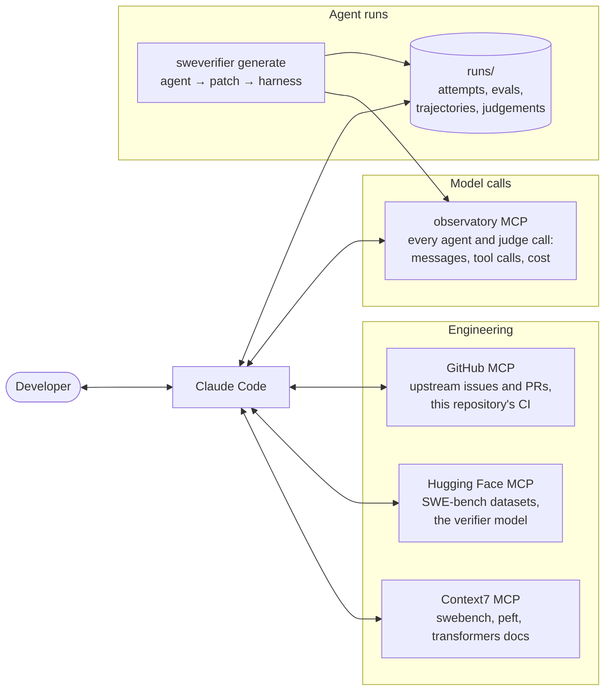

# Development workflow: Claude Code + MCP

Working on a coding agent is mostly reading what it did: 600 trajectories of up to 40 tool calls, 600 harness
reports, 1,000 judge reviews. This project is set up so that an AI coding agent (Claude Code) can take part in
that loop through the [Model Context Protocol](https://modelcontextprotocol.io). It can read the agent's traced
runs, the issues and pull requests, and the datasets, and query current library docs.

The servers are declared in [`mcp.example.json`](mcp.example.json). Copy it to `.mcp.json` at the repository
root and Claude Code will offer to enable them when it opens the project. Credentials come from environment
variables. **None of them is needed to run, test or reproduce the results.**

## Architecture

| Server | What it is for here | Access |
|---|---|---|
| **observatory** ([agent-observatory](https://github.com/LacosteEvan/agent-observatory)) | The agent's and the judges' calls, traced: find every trajectory that hit the step limit after a failed `edit`, compare two prompt versions on the same issues | Read-only |
| **GitHub** | Read an issue's upstream discussion and the PR that fixed it, when a failure needs explaining; CI status and PRs of this repository | Fine-grained PAT, public repos read-only, this repository read-write |
| **Hugging Face** | SWE-bench Lite and newer issue sets (SWE-rebench, SWE-bench Live); publish the verifier with its evaluation table | Token, write on the project's repos only |
| **Context7** | Current docs for `swebench`, `peft` and `transformers`, whose APIs move between releases | Public |

## Loops it enables

**1. Why does the agent fail on Django?**
Claude reads the Django trajectories in `runs/trajectories/`, or queries observatory for them, and counts what
the agent ran: it calls `pytest`, which is not installed in Django's environment, instead of
`tests/runtests.py`. It proposes one line in the system prompt, and the change is measured on a fresh seed of
issues, never on the ones it was found on.

**2. Is the judge verifying or remembering?**
For a review that names "the upstream fix", Claude opens the upstream PR through GitHub and checks whether the
judge describes the merged change rather than the candidate patch. That check is how the contamination in the
README was found and then measured.

**3. A newer benchmark.**
Claude loads issues created after the models' training cutoff from Hugging Face, checks that their images run
under the harness, and reruns `sweverifier generate` on them with a `--max-cost` cap.

## Guardrails

- **Credentials are never committed.** They come from `OPENROUTER_API_KEY` (in `.env`, git-ignored),
  `OBSERVATORY_DB_URL`, `GITHUB_PAT` and `HF_TOKEN`.
- **The agent's containers have no network.** It works from the repository and the issue text only, and cannot
  look the fix up.
- **Every paid run is capped.** `generate` and `judge` refuse to start without `--max-cost`, and Claude Code asks
  for confirmation before any of them.
- **The hidden tests stay hidden.** Only the harness sees them; no verifier, prompt or feature is tuned on their
  output beyond the labels used out of fold.
